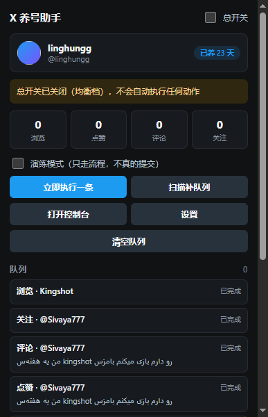
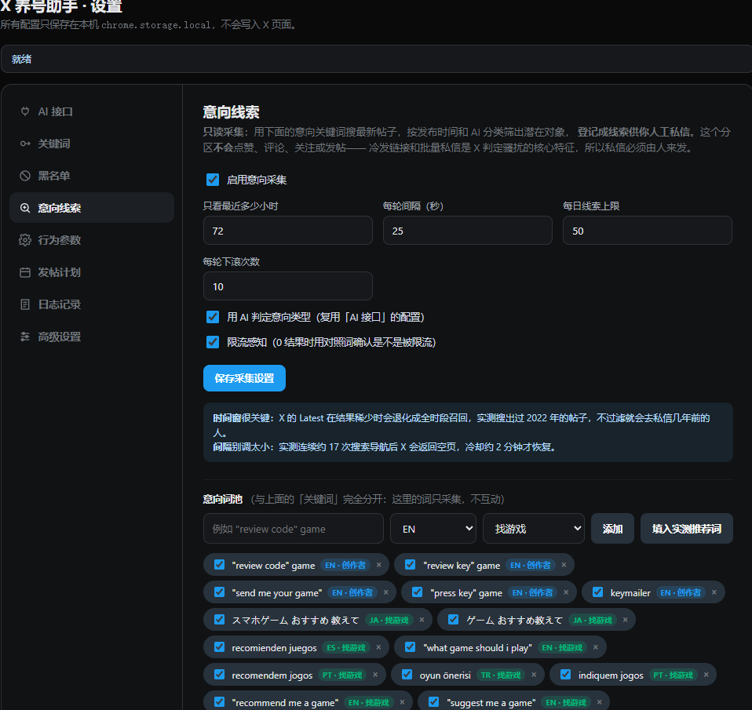
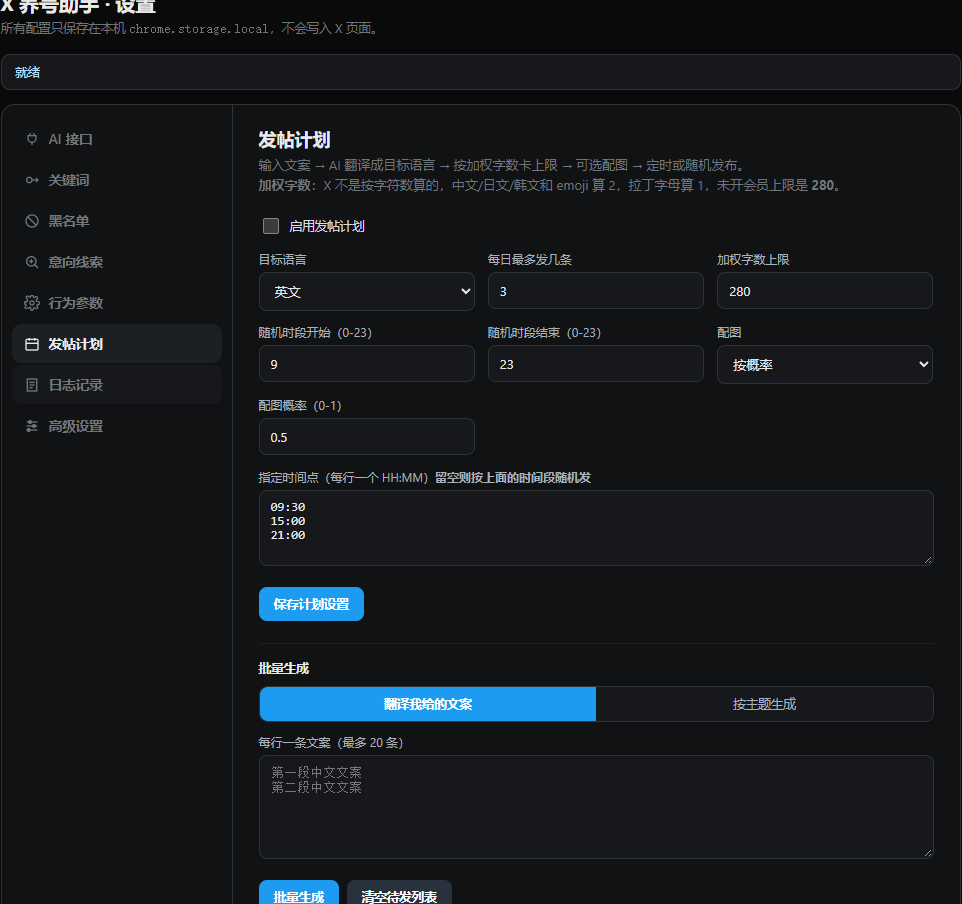
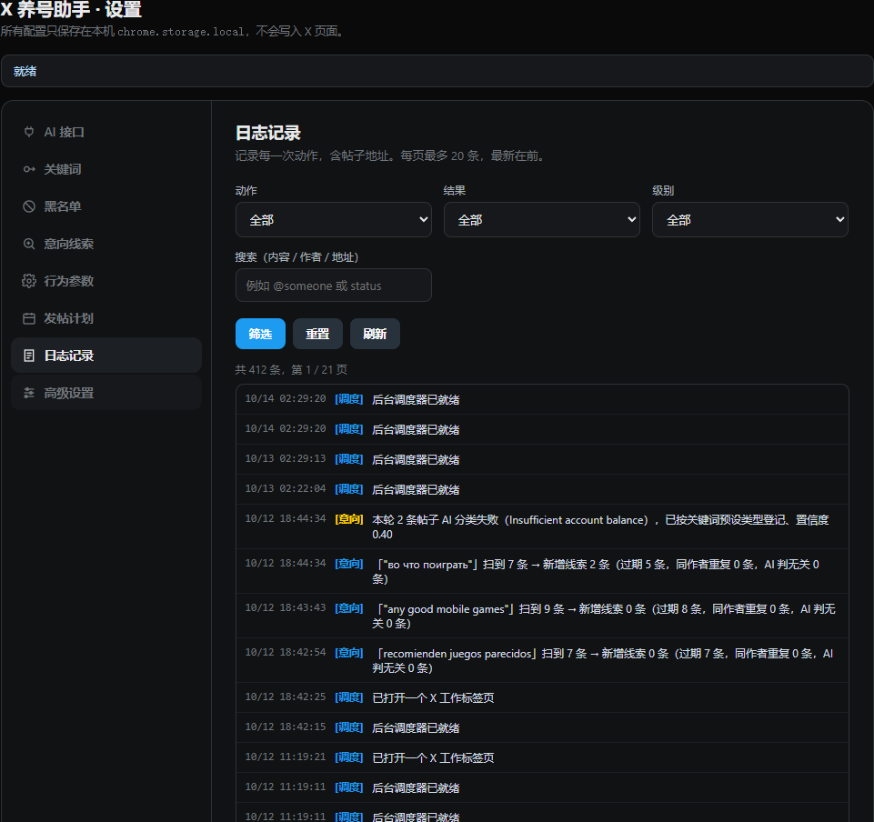

<div align="center">

<p><strong>简体中文</strong> | <a href="README.en.md">English</a></p>

<p><strong>不降质GPT 满血claude调用：</strong> <a href="https://www.1openai.icu/">https://www.1openai.icu/</a><br>高质量 不掺水 物超所值 欢迎使用和测试</p>

<h1>X 养号助手</h1>

<p><strong>基于 AI 的 X（Twitter）全自动养号与内容发布浏览器插件</strong></p>
<p>自动搜索 · 自动浏览 · 自动点赞 · AI 评论 · 自动关注 · 定时图文发布 · 意向线索采集</p>

<p>
  
  
  
  
  
</p>

<p><a href="dist/x-nurture-helper-0.6.1.zip"><strong>下载插件 ZIP（v0.6.1）</strong></a> · <a href="#快速开始">快速开始</a> · <a href="#界面预览">界面预览</a> · <a href="#技术栈">技术栈</a> · <a href="#交流与支持">交流与支持</a></p>

</div>

## 项目介绍

X 养号助手是一款运行在浏览器里的 Chrome Manifest V3 扩展。配置好关键词、AI 接口和运行节奏后，插件会在已登录的 X 页面中，自动完成搜索、筛选、入队、内容生成、互动执行和结果检查。

**全自动是核心：开启后，浏览、点赞、AI 评论、关注和发帖任务由调度器持续执行，无需逐条点击确认。** 你可以自由选择要启用的动作，也可以只运行内容发布或意向线索采集。

插件直接使用浏览器中已有的 X 登录状态，通过页面 DOM 完成操作；无需部署后端，也无需配置 X 开发者 API Key。AI 评论、翻译、内容生成和生图使用你自己配置的 OpenAI 兼容接口。

> 首次安装默认关闭总开关、开启演练模式。完成配置并手动启用后，才会自动执行真实互动。浏览器需要保持运行，账号需要保持登录。

## 核心功能

| 功能 | 说明 |
| --- | --- |
| 全自动互动 | 按关键词轮询搜索最新帖子，自动生成浏览、点赞、评论和关注任务 |
| AI 智能评论 | 根据原帖生成评论，默认跟随原帖语言，可指定语言和评论风格 |
| 自动内容发布 | 支持按主题批量生成帖子，或将已有文案翻译、润色后加入待发列表 |
| 定时与随机发布 | 支持指定 `HH:MM` 时间点，或在设定时段内按节奏发布 |
| AI 生成配图 | 发帖时可关闭配图、按概率配图或总是配图；生成失败会记录日志并回退为纯文字 |
| 意向线索采集 | 按意向关键词、发布时间和 AI 分类筛选线索，支持跟进状态、备注和 CSV 导出 |
| 三档运行节奏 | 保守、均衡、激进三档，各自保存参数，支持动作间隔、总额度和分动作额度 |
| 随机滚动与停顿 | 动作之间插入滚动、停顿等页面操作，可调整相关参数 |
| 风控自动暂停 | 检测验证码、验证流程或账号受限等信号后暂停，记录原因并发送通知 |
| 实时状态与日志 | 扩展弹窗、页面控制台、任务进度、今日统计、分类日志和帖子链接 |
| 去重与黑名单 | 已处理帖子去重、相似评论检查、作者黑名单和内容词过滤 |
| 演练模式 | 执行导航、扫描和内容生成流程，跳过真实点赞、关注和提交，便于检查配置 |

## 界面预览

### 插件弹窗

查看运行状态、今日统计和任务队列，直接控制总开关、演练模式以及单次执行。

<table align="center">
  <tr><td align="center"></td></tr>
</table>

### 意向线索采集

独立的意向词池、时间窗口、AI 分类和限流感知，适合筛选找游戏的玩家和寻找评测机会的创作者。

<table align="center">
  <tr><td align="center"></td></tr>
</table>

### 自动发帖计划

设置目标语言、每日数量、发布时间和配图策略，批量准备内容后交给插件自动发布。

<table align="center">
  <tr><td align="center"></td></tr>
</table>

### 运行日志

按动作、结果、级别和关键词筛选日志，检查任务执行过程和失败原因。

<table align="center">
  <tr><td align="center"></td></tr>
</table>

## 快速开始

### 1. 安装插件

1. 下载 [插件 ZIP（v0.6.1）](dist/x-nurture-helper-0.6.1.zip)，解压到固定文件夹。
2. 打开 Chrome，在地址栏输入 `chrome://extensions/`。
3. 开启右上角的「开发者模式」。
4. 点击「加载已解压的扩展程序」，选择解压后**包含 `manifest.json` 的文件夹**。
5. 打开 `https://x.com/` 并登录自己的账号，再点击工具栏中的「X 养号助手」。

使用源码时，也可以直接加载仓库根目录，无需先安装 npm 依赖或执行构建。ZIP 需要先解压，不能直接作为已解压扩展加载。

### 2. 配置 AI 接口

进入「设置 → AI 接口」，填写并保存：

| 配置项 | 说明 |
| --- | --- |
| Base URL | 支持 OpenAI 兼容接口地址，末尾可以带或不带 `/v1` |
| API Key（文字模型） | 用于 AI 评论、翻译、文案生成和意向分类 |
| 生图 API Key | 用于生成发帖配图；留空时复用文字模型 Key |
| 文本模型 | 填写服务商实际支持的模型 ID；代码默认值为 `gpt-4o-mini` |
| 生图模型 | 填写支持图片生成的模型 ID；代码默认值为 `gpt-image-1` |
| 图片尺寸 | 可选 `1024x1024`、`1536x1024`、`1024x1536`，以服务商支持情况为准 |

点击「测试连接」检查文字接口。该按钮只测试文字模型，生图需要通过带图发帖流程另行检查。

接口需要支持 `/v1/chat/completions`；使用配图时还需要支持 `/v1/images/generations`。模型名称可以自行更换，无需修改源码。

### 3. 配置全自动互动

1. 在「关键词」中添加你关注的话题，调度器会轮流用这些关键词搜索。
2. 在「行为参数」中选择运行档位，勾选需要的浏览、点赞、评论、关注或发帖动作，并保存。
3. 回到插件弹窗，打开「总开关」。首次使用可先保持「演练模式」，查看队列和日志。
4. 确认配置后关闭「演练模式」，插件便会按设定节奏自动执行真实动作。

演练仍会导航页面、扫描帖子，并可能调用 AI 接口产生费用；它跳过的是实际互动和发布提交。没有互动关键词时，关键词扫描无法生成互动任务。

### 4. 配置自动发帖

进入「发帖计划」，选择以下一种方式准备待发内容：

- **翻译我给的文案**：每行输入一条原文，批量翻译、润色为目标语言。
- **按主题生成**：填写主题和条数，让 AI 批量生成目标语言的帖子。

设置每日上限、配图策略和发布时间，保存并启用发帖计划。填写 `HH:MM` 时按指定时间点调度；清空时间点则在设定时段内按节奏发布。

计划帖同样需要打开总开关、关闭演练模式，并受「行为参数」中的活跃时段、总额度和发帖额度限制。**保守档默认发帖额度为 0**，需要调整后才能发布。

当前发送前会把文案限制在 **280 个加权单位**内；中文等字符与多数 emoji 按 2 单位计，普通拉丁字母按 1 单位计。计划页虽可设置更高的生成上限，实际自动提交前仍会按代码中的 280 单位限制截断。

## 意向线索采集

意向采集使用独立开关和独立关键词池，可以单独启用，也可以与自动互动交替运行。当前内置的分类方向是「找游戏」和「创作者」，并预置多语言意向关键词。

- 按发布时间过滤，减少过期线索。
- 滚动时逐屏采集，按帖子地址和作者去重。
- 复用 AI 接口判断意向类型，保留分类理由和置信度。
- 支持未处理、已私信、已回复、已转化、已忽略等跟进状态。
- 支持搜索、备注和 CSV 导出，便于后续整理。

**线索采集只负责筛选和登记，私信由你人工跟进。** 意向词池与互动词池分开，采集本身不会触发点赞、评论或关注。AI 分类失败时会记录日志，并按关键词预设类型以较低置信度登记。

## 运行节奏与保护机制

| 参数 | 保守 | 均衡（默认） | 激进 |
| --- | --- | --- | --- |
| 动作随机间隔 | 180–480 秒 | 60–240 秒 | 30–120 秒 |
| 每小时总动作上限 | 4 | 10 | 20 |
| 每日总动作上限 | 20 | 60 | 150 |
| 每轮扫描目标条数 | 5 | 12 | 20 |
| 每轮最多关注数 | 1 | 2 | 4 |
| 发帖上限（每小时 / 每日） | 0 / 0 | 1 / 4 | 2 / 8 |

三档分别保存各自参数，切换档位后可继续使用之前的设置。总动作额度与分动作额度同时约束执行，任意一项达到上限都会暂停相应任务。演练不消耗动作配额。

此外，插件提供连续失败冷却、活跃时段、内容相似度检查、黑名单及验证码检测。检测到风控信号时会关闭总开关、显示提示并记录日志，需要人工确认账号状态后重新开启。

页面操作后会检查点赞、关注或提交状态；超时和页面错误会写入日志。页面检测结果仍应结合账号实际状态判断。

## 技术栈

| 层面 | 实现 |
| --- | --- |
| 扩展标准 | Chrome Extensions Manifest V3 |
| 开发语言 | 原生 JavaScript，ES Modules；HTML / CSS 界面 |
| 后台调度 | Service Worker、`chrome.alarms`、持久化任务队列 |
| 页面执行 | Content Script，DOM 查询、输入、点击和滚动 |
| 通信 | `chrome.runtime` 消息通信，由后台统一写入状态 |
| 本地存储 | `chrome.storage.local`，保存配置、队列、统计、日志和线索 |
| AI 接入 | `fetch` 调用 OpenAI 兼容文字与图片生成接口 |
| 测试 | Node.js 内置 `node:test` 与 `assert` |
| 打包 | Node.js 原生文件系统与 `zlib`，生成 ZIP 和可加载目录 |
| 依赖 | 无第三方运行依赖，无前端框架和打包器 |

自动化执行链路：

```text
关键词轮询 → 搜索与筛选 → 去重与黑名单 → 任务队列
                                          ↓
                 间隔 / 时段 / 配额检查 → 页面执行 → 结果检查
                                          ↓
                                   统计、日志与下次调度

发帖计划 → 到期入队 → 同一执行流程
意向词池 → 独立采集 → AI 分类 → 线索列表 / CSV
```

### 目录结构

```text
├── manifest.json          # 扩展清单与权限声明
├── src/
│   ├── background/        # 调度、任务执行编排与 AI 请求
│   ├── content/           # X 页面 DOM 操作与页面控制台
│   ├── popup/             # 工具栏弹窗
│   ├── options/           # 设置、发帖计划、线索和日志界面
│   └── lib/               # 护栏、存储、图片和日志逻辑
├── icons/                 # 扩展图标
├── img/                   # README 截图与交流、赞赏二维码
├── scripts/               # 打包与校验脚本
├── tests/                 # 自动化测试
├── probe/                 # 开发用浏览器探测脚本
└── dist/                  # 插件 ZIP 与本地解压目录
```

## 本地开发与打包

开发脚本需要支持 `import.meta.dirname` 的较新 Node.js 版本，建议使用 Node.js 22 或更新版本。项目没有第三方依赖，可直接运行：

```bash
npm test                         # 运行现有自动化测试
npm run check                    # 检查 JavaScript 语法
npm run package                  # 生成插件 ZIP 与可加载目录
node scripts/verify-package.mjs   # 在 Windows / PowerShell 下校验解压、内容及图标
```

当前版本产物：

```text
dist/x-nurture-helper-0.6.1.zip
dist/x-nurture-helper-0.6.1/
```

分发包包含扩展运行文件、中英文 README 和展示图片，排除浏览器调试资料、探测脚本及测试文件。修改源码后重新打包，在扩展管理页点击「重新加载」，并刷新 X 页面。

## 数据与权限

配置、API Key、任务状态、日志和线索保存在本机 `chrome.storage.local`。AI 功能会把相关原帖、文案或提示词发送到你配置的接口；登录状态由浏览器中的 X 会话提供。

| 权限 | 用途 |
| --- | --- |
| `storage` | 保存接口配置和运行数据 |
| `tabs` | 查找和管理 X 工作标签页 |
| `alarms` | 唤醒后台调度、执行计划任务 |
| `scripting` | 在需要时注入页面执行脚本 |
| `notifications` | 发送风控暂停等系统通知 |
| X / Twitter 站点访问 | 执行页面扫描与互动 |
| `<all_urls>` | 连接用户自定义的 AI 接口地址及下载返回的图片；内容脚本仅自动匹配 X / Twitter 页面 |

提交 Issue、截图或分享配置时，请先去掉 API Key、Cookie 和个人数据。

## 常见问题

**开启后没有动作？**

检查总开关、演练模式、互动关键词和动作开关，再看日志是否提示额度用完、冷却、活跃时段限制或账号验证。发帖计划还需要有待发内容和可用的发帖额度。

**关闭浏览器后还会运行吗？**

不会。这是浏览器扩展，自动化依赖浏览器运行、页面可用和 X 登录状态。电脑休眠或浏览器关闭期间，无法保证按时执行。

**后台工作标签页执行很慢？**

浏览器可能限制后台页面的渲染与计时。可以在「高级设置」中开启执行时把工作标签页切到前台，再结合日志检查。

**可以用其他 AI 服务商吗？**

可以，只要提供插件所需的 OpenAI 兼容接口。文字和生图模型分别填写服务商支持的模型 ID；两类 API Key 也可以分开配置。

**支持多账号或自动私信吗？**

当前插件使用所在浏览器配置中的 X 会话，没有内置账号切换或自动私信。意向线索的私信跟进需要人工完成。

## 反馈与贡献

欢迎通过 Issue 反馈问题，或提交聚焦具体问题的 Pull Request。反馈时请附上插件版本、浏览器版本、复现步骤和脱敏日志；修改代码后请运行相关测试与语法检查。

自动化行为可能触发平台限制，运行频率、内容及账号使用方式应由使用者自行评估。随机停顿、配额和风控检测不能保证账号安全，也不保证涨粉或转化效果。本项目与 X / Twitter 官方无关联。

## 交流与支持

欢迎扫码交流使用体验、反馈问题。如果这个项目对你有帮助，也欢迎自愿赞赏，支持后续维护。

<table align="center">
  <tr>
    <th align="center">微信交流</th>
    <th align="center">赞赏支持</th>
  </tr>
  <tr>
    <td align="center"></td>
    <td align="center"></td>
  </tr>
  <tr>
    <td align="center">扫码添加微信，交流与反馈</td>
    <td align="center">感谢支持，赞赏完全自愿</td>
  </tr>
</table>
